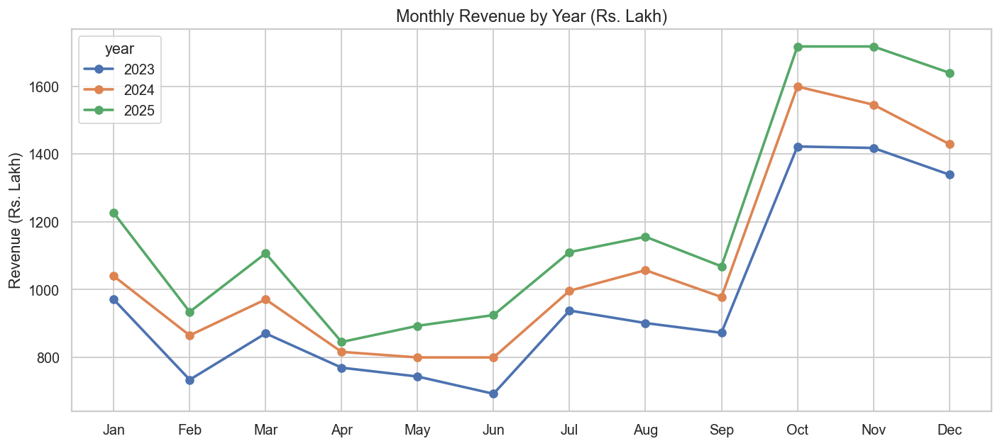
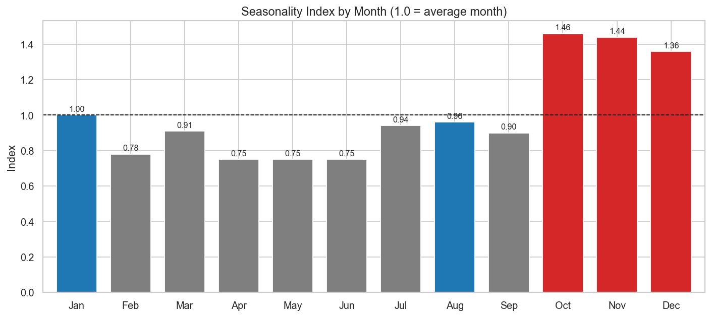
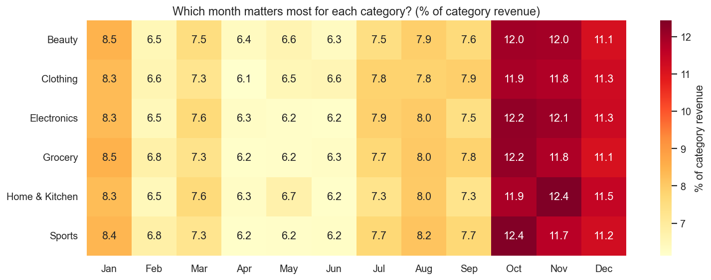
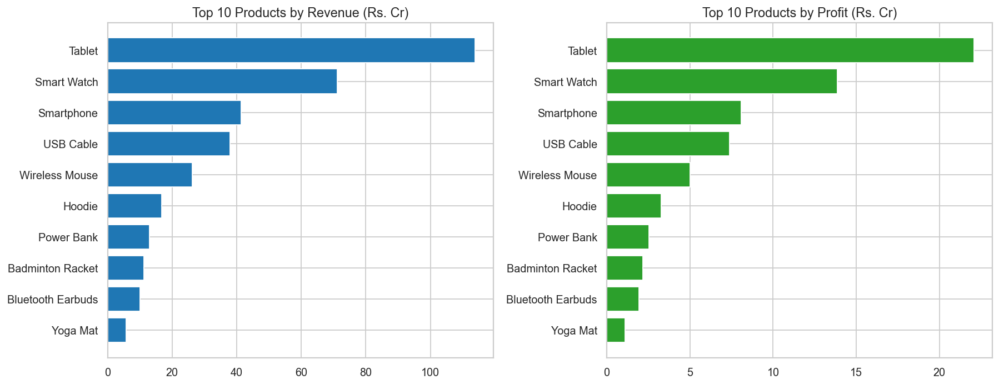
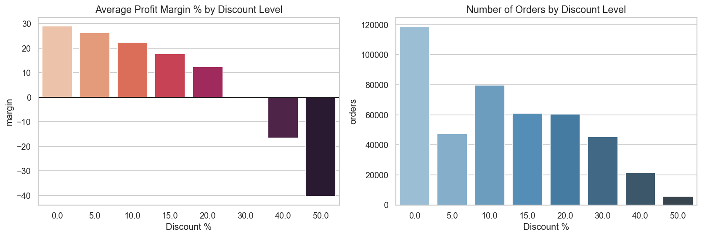

# Retail Sales Exploratory Data Analysis (EDA)

Exploratory analysis of a **505,000-order retail sales dataset (Jan 2023 - Dec 2025)** to find top-performing products, seasonal demand trends and the impact of discounts, with recommendations for inventory and sales decisions.

**Tech stack:** Python · Pandas · NumPy · Matplotlib · Seaborn · Jupyter Notebook

---

## Business Questions
1. Which products and categories drive the most revenue and profit?
2. How does demand change across months, seasons and weekdays?
3. Which cities and payment methods matter most?
4. How do discounts affect profit margin?
5. How much revenue is lost to returns and cancellations?

## Dataset
Synthetic retail data with 18 columns: order and customer details, product and category, price, quantity, discount, sales, profit, payment method, store type, city/state, order status and rating.

The data is **intentionally messy** to practise real-world cleaning: duplicates, mixed date formats, inconsistent text, negative prices, quantity outliers and missing values.

| File | Purpose |
|---|---|
| `retail_sales_sample.csv` | First 10,000 rows, enough to run the notebook quickly |
| `generate_data.py` | Recreates the full 505,000-row dataset (`retail_sales_data.csv`) with a fixed seed |

> All results below come from the **full dataset**. Run `python generate_data.py` first to reproduce them; on the sample, the numbers will differ.

## Approach
1. **Data understanding:** shape, data types, missing values, duplicates, summary statistics
2. **Cleaning:**
   - Removed 5,000 duplicate rows
   - Fixed mixed date formats (`YYYY-MM-DD` and `DD/MM/YYYY`)
   - Standardised text (case, extra spaces, `Bangalore` → `Bengaluru`)
   - Corrected 264 negative prices
   - Treated quantity outliers (IQR check plus a business rule of no more than 20 units per order)
   - Handled missing values using median, zero and "Unknown" as appropriate
3. **Feature engineering:** year, month, quarter, weekday, weekend flag, profit margin %, season
4. **Analysis and visualisation:** revenue trend, seasonality index, category × month heatmap, top products, Pareto (80/20), discount vs margin, city/payment/segment, returns and cancellations, correlation

## Key Findings

| Area | Insight |
|---|---|
| Seasonality | Oct, Nov and Dec run at about 1.4× the average month; Apr-Jun is the slump at about 0.75× |
| Growth | Revenue grew from Rs. 116.7 Cr (2023) to Rs. 128.9 Cr (2024) and Rs. 143.4 Cr (2025), roughly +10-11% a year |
| Weekends | Average daily revenue is about 25% higher on Saturday and Sunday |
| Categories | Electronics generates about 80% of revenue; Sports has the most orders but a small revenue share |
| Concentration | 7 of 48 products generate 80% of revenue |
| Discounts | Margin falls from 29% (no discount) to 0% at 30% off and -40% at 50% off; quantity per order does not rise with discounts |
| Loss-making orders | 13.1% of delivered orders lose money, all at 20%+ discount |
| Payments and channel | UPI is about 38% of revenue; online is about 65% |
| Leakage | Returns and cancellations lose about 12% of gross order value (Rs. 54 Cr) |

## Recommendations
- Build inventory and marketing plans from September for the Oct-Dec peak
- Cap discounts at 15-20%; deeper discounts do not increase units sold and destroy margin
- Protect stock of the top sellers (Tablet, Smart Watch, Smartphone)
- Run weekend campaigns to use the weekend uplift
- Investigate the roughly 7% return rate, especially for high-value Electronics

## Sample Visuals






## How to Run
```bash
git clone https://github.com/<your-username>/retail-sales-eda.git
cd retail-sales-eda
pip install pandas numpy matplotlib seaborn jupyter
python generate_data.py          # creates retail_sales_data.csv (full data)
jupyter notebook Retail_Sales_EDA.ipynb
```
To use the small sample instead, change the file name in the first code cell to `retail_sales_sample.csv`.

## Project Structure
```
retail-sales-eda/
├── Retail_Sales_EDA.ipynb
├── generate_data.py
├── retail_sales_sample.csv
├── charts/
└── README.md
```

## Limitations
- The dataset is **synthetic**, so patterns such as seasonality and the discount effect reflect how it was generated rather than a real company. The same workflow applies to real data.
- Ratings do not vary by order status, and every category shares the same seasonal shape, which would be unusual in real data.
- `sales_amount` and `profit` were used as recorded and not recomputed after quantity outliers were imputed.

## Author
**Vinit Ranjan Jha**: aspiring Data Analyst (Excel, Power BI, SQL, Python)
